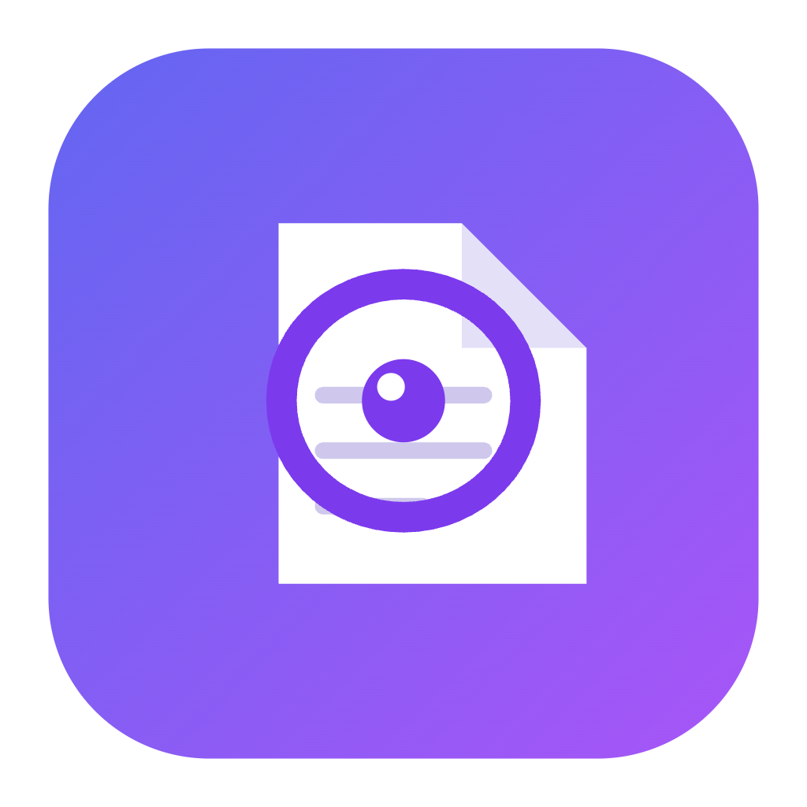
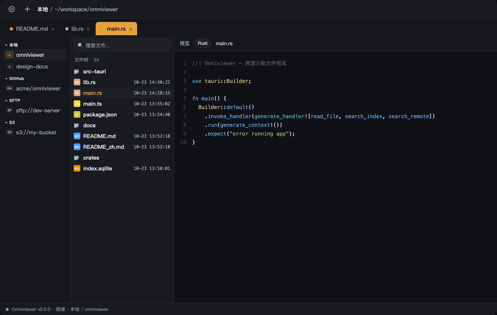

<div align="center">
  
  <h1>Omniviewer</h1>
  <p><strong>任何来源，任何格式，一眼看清。</strong></p>
  <p>跨源万能文件预览桌面应用 —— 附带全文检索、水印、CLI，以及一个 MCP 服务器，让 AI 智能体也能读取并引用你所看到的一切文件。</p>
</div>



## 什么是 Omniviewer？

Omniviewer 从**任何地方**预览文件 —— 本地磁盘、GitHub、GitLab、SFTP、WebDAV、S3 或普通 HTTP 服务器 —— 统一在一个三栏界面里，无需先下载，也无需打开第三方软件。

它内联渲染 **275+ 种格式**（Office 文档、PDF、代码、图片、音频、视频、压缩包、AI 模型文件等）。在「查看」之上，它还叠加了跨源全文检索、可溯源水印、统一 CLI，以及一个 MCP 服务器，把应用变成 AI 智能体的「文件 + 检索」后端。

## 核心亮点

- 🗂 **七大数据源，一棵树** —— 本地 / GitHub / GitLab / HTTP / WebDAV / SFTP / S3 并排浏览，本地可同时打开多个目录。
- 👁 **万能预览** —— file-viewer 内核内联渲染 275+ 格式，不下载、不开第三方软件。
- 🔍 **全文检索** —— FTS5 + jieba 分词，**中英文同等对待**（分词 + 标识符拆分 + 2-gram）。
- 🖼 **多标签页** —— 一次打开多个文件，切换标签时数据源树和文件树的选中状态同步跟随。
- 🎨 **可换肤** —— 设置页调色板可自定义每个界面元素（暗/亮）和每个代码 token（Dracula / GitHub Light 预设），实时生效。
- 🛡 **水印** —— 明水印（按格式）+ 暗水印（抗截图点阵），均可溯源到用户标识。
- 💾 **下载与打包** —— 下载文件/文件夹、打包加密 ZIP（内置密码管理）。
- 🏭 **生产级** —— 大文件流式分块读取、LRU 预览缓存带淘汰、断点续传带重试、可溯源的明水印 + 暗水印。
- ⌨ **CLI** —— 一个 `omniviewer` 二进制：`search / index / cat / ls / cache / wm / conn / mcp / status / version`。
- 🤖 **MCP 服务器** —— 通过 Streamable HTTP 或 stdio 把数据源与检索能力暴露给任意 AI 智能体。

## 数据源

| 数据源 | 说明 |
| --- | --- |
| **本地** | 本机任意文件夹（可同时打开多个，树形展示） |
| **GitHub** | 浏览公开/私有仓库（Token 鉴权） |
| **GitLab** | 浏览 GitLab 项目与子组 |
| **HTTP** | 静态文件服务器 / 目录列表 |
| **WebDAV** | WebDAV 共享 |
| **SFTP** | SSH 文件服务器 |
| **S3** | Amazon S3 及 S3 兼容存储桶 |

## 文件格式（275+）

- **文档** —— PDF、DOC/DOCX、XLS/XLSX、PPT/PPTX、ODT/ODS/ODP、RTF、TXT、CSV、OFD
- **代码** —— 数百种编程语言语法高亮
- **图片** —— PNG、JPEG、GIF、SVG、WebP、BMP、ICO、TIFF
- **音视频** —— MP3、WAV、FLAC、OGG、MP4、WebM、MOV
- **压缩包** —— ZIP、RAR、7Z、TAR、GZ（应用内解压，支持加密 ZIP）
- **模型文件** —— ONNX、GGUF、safetensors、.pt/.pth、.h5/.keras、.tflite
- **其他** —— Markdown、EPUB、HTML

→ 完整清单：[docs/zh/formats.md](docs/zh/formats.md)（275 个扩展名 · 18 个类别）。

不支持的格式也会像 VS Code 一样以纯文本打开（哪怕是乱码），绝不显示「安装插件」之类的提示。

## AI 与 MCP

Omniviewer 内置 [MCP](https://modelcontextprotocol.io) 服务器，让 AI 智能体（Claude Desktop、Cursor、自定义智能体……）能读取你的文件、检索所有已连接的数据源：

```bash
omniviewer mcp                                   # stdio（本地智能体）
omniviewer mcp --http --port 8765 --key <密钥>    # Streamable HTTP（本地 + 远程智能体）
```

| 工具 | 说明 |
| --- | --- |
| `search` | 跨本地 + 远程数据源全文检索 |
| `list_files` | 列出目录（本地或远程） |
| `read_file` | 读取文件内容（Office/PDF 自动抽取文本） |
| `get_file_info` | 文件元信息 |

## CLI

一个二进制，十个子命令。在「**设置 → 关于 → 安装 CLI 到 PATH**」安装（随 App 打包分发），即可在终端运行 `omniviewer`：


```bash
omniviewer search  <查询词>      # 全文检索（--remote 可包含已缓存的远程文件）
omniviewer index   <路径>        # （重新）构建检索索引
omniviewer cat     <文件>        # 输出文件文本内容
omniviewer ls      <路径>        # 列出目录
omniviewer cache   <子命令>      # 管理预览缓存
omniviewer wm      <子命令>      # 水印编码 / 解码
omniviewer conn    <子命令>      # 列出 / 添加 / 删除连接
omniviewer mcp     [--http]      # 启动 MCP 服务器
omniviewer status                # 数据源、索引、缓存状态
omniviewer version               # 输出版本号
```

## 快速开始

```bash
pnpm install
pnpm tauri dev        # 运行桌面应用（首次编译 Rust 较慢）
pnpm tauri build      # 打包发行版
```

详见 [安装说明](docs/zh/install.md)、[使用说明](docs/zh/usage.md)、[配置说明](docs/zh/configuration.md)。

## 文档

- [产品介绍](docs/zh/introduction.md)
- [安装说明](docs/zh/install.md)
- [使用说明](docs/zh/usage.md)
- [配置说明](docs/zh/configuration.md)
- [支持格式](docs/zh/formats.md)
- [变更记录](CHANGELOG.md)

## 技术栈

Tauri 2 · Rust（rusqlite/FTS5、jieba-rs、rmcp、clap、axum）· Vite 8 + TypeScript（vanilla）· file-viewer 渲染内核

## 许可证

[AGPL-3.0](LICENSE) —— GNU Affero 通用公共许可证 v3.0。

## 赞助

如果 Omniviewer 对你有帮助，欢迎赞助支持开发：

<div align="center">
  
  
</div>
